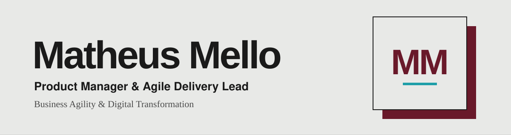

[English](README.md) · [Português](README.pt.md) · **🌐 Español**

*Convierto problemas en productos que la gente usa, y estoy construyendo flujos de trabajo asistidos por IA para equipos de producto y proyecto!*

---

## 🧭 Empieza aquí

| Si necesitas… | Ve a |
|---|---|
| Skills para **Product/Project Managers** (discovery, priorización, specs) | [Product and Project Manager Skills](https://github.com/matheusmello00/Product-and-Project-Manager-Skills) |
| Skills para **Agile Coaches** (facilitación, delivery, retros) | [Agile Delivery Skills](https://github.com/matheusmello00/Agile-Delivery-Skills) |

## 🔭 Explorando ahora

- 🤖 **Claude Architect** (preparación para la certificación) y flujos avanzados de Claude Code
- 📈 **Product Analytics & Growth** (discovery y escalado basados en datos)
- 🚀 Iniciativas de **AI Builder** e integración de IA en el SDLC
